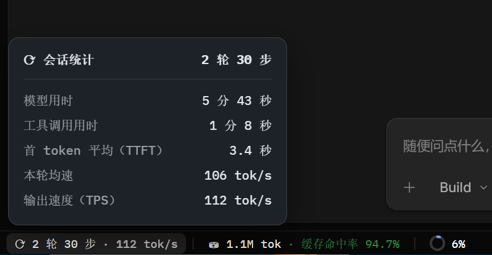
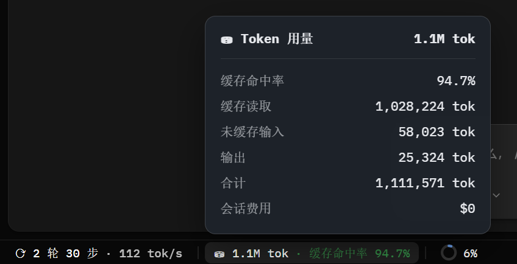
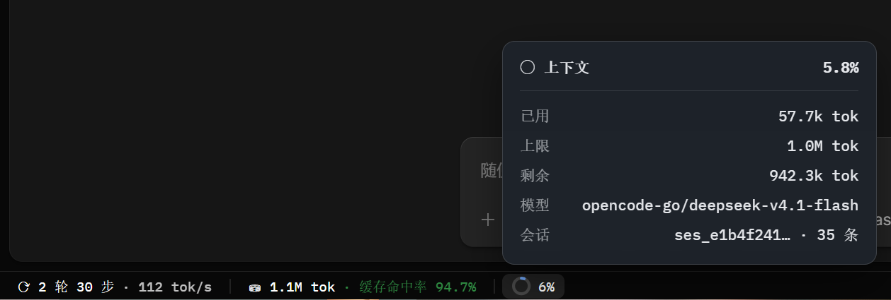

# opencode-infobar

[简体中文](README.md) · **English**

A bottom status bar for **OpenCode Desktop** — prompt-cache hit rate, token speed and a context ring, in one DSH-style strip. Every segment is clickable and opens the numbers behind it.



```
⟳ 3 轮 93 步 · 90 tok/s  │  ⛁ 16.9M tok · 缓存命中率 98%  │  ◔ 27%
```

## Why this exists

OpenCode Desktop never shows you how well the prompt cache is working, how fast tokens are actually arriving, or how close the context window is to the limit. The TUI has community plugins for that, but **Desktop does not run TUI plugins** — it only mounts the GUI part (`./gui-experimental`) of a plugin, and the GUI plugin API exposes a `window.bottom` slot. This plugin fills that slot and nothing else.

## Features

- **Three segments**, DSH-style: rounds/steps + speed │ total tokens + cache hit rate │ context ring.
- **Click to drill in** — a card per segment, closes on outside click or `Esc`:
  - `⟳` rounds, steps, model time, tool time, average TTFT, current speed
  - `⛁` cache read, uncached input, output, total, session cost
  - `◔` context used / limit / free, model, session
- **Colour that means something** — hit rate ≥85% green, ≥70% amber, below that red; context ring fills blue, then amber at 80%, red at 95%.
- **Light and dark** — the strip inherits the app's text colour; the cards and ring pick their palette from the app appearance mode.
- **Zero build step** — one hand-written CommonJS file, no bundler, no dependencies, nothing to compile.
- **Testable without the app** — `node test/smoke.cjs` renders the strip against a fake session and asserts the numbers.

## Screenshots

| Token usage card | Context card |
| --- | --- |
|  |  |

Captured on a real session, so the numbers are whatever that session happened to do.

## Requirements

- **OpenCode Desktop 2.3.0 or newer** (the GUI plugin API is marked experimental and may change between releases).
- Nothing else. No `@opencode/plugin` install on your side — the app provides the shared modules.

## Install

1. Clone the repo:

   ```bash
   git clone https://github.com/homecom2233/opencode-infobar ~/plugins/opencode-infobar
   ```

   (Or copy the folder anywhere by hand — it is just a handful of files.)
2. Add it to your **global** config, `~/.config/opencode/opencode.json`:

   ```json
   {
     "$schema": "https://opencode.ai/config.json",
     "plugins": ["~/plugins/opencode-infobar"]
   }
   ```

   Use an absolute path. Relative paths resolve from the config file that contains the entry.
3. Reload the OpenCode window (`Ctrl+R`) — the strip appears at the bottom, above toasts.

The plugin id is the package name / directory name, so **the folder name matters**: rename the folder and you get a different plugin id.

To update after pulling changes, just reload the window; the Desktop app re-reads the bundle from disk on every load. There is no cache to clear for a directory install (unlike npm packages, which OpenCode pins at the first resolved version).

## What the numbers mean

| Segment | Value | Formula |
| --- | --- | --- |
| `⟳ 3 轮 93 步` | rounds = user messages, steps = LLM calls | counted from the loaded message window |
| `· 90 tok/s` | decode speed of the latest step | `(output + reasoning) / decode window` |
| `⛁ 16.9M tok` | session total tokens | `input + cacheWrite + cacheRead + output + reasoning` |
| `· 缓存命中率 98%` | prompt-cache hit rate | `cacheRead / (input + cacheRead + cacheWrite)` |
| `◔ 27%` | context occupancy | `(input + cacheRead)` of the latest step ÷ the model's `limit.context` |

Token totals come from `SessionInfo.tokens` — the session-level aggregate the server keeps — so they are complete even when message history is paginated.

### The token-speed question

Tool execution happens *between* assistant messages, so a per-message window already excludes tool waits. The error comes from inside the window. Measured over 213 real assistant messages on one machine (median tok/s):

| Window | Includes | Median |
| --- | --- | --- |
| `created → completed` | first-token wait **and** step finalisation | 38.6 tok/s |
| `contentFirst → completed` | drops the first-token wait, keeps finalisation | 86.7 tok/s |
| **`contentFirst → streamed`** | **pure decode** — what this plugin uses | **136.0 tok/s** |

`time.firstToken` is reported rarely (8 of 215 messages here), so the start is `firstToken ?? earliest text/reasoning part time.created ?? created` — tool parts are excluded, they are created at the end of the stream. The end is `streamed ?? completed`. "Model time" in the card uses `created → last chunk` instead, so it complements "tool time" rather than duplicating decode time.

## Commands

Both live in the command palette:

| Command | Id | Does |
| --- | --- | --- |
| Hide/show the bar | `opencode-infobar.toggle` | toggles the strip until the window reloads |
| Copy diagnostics | `opencode-infobar.copy` | copies every raw number as JSON — useful when a value looks wrong |

## Customising

Everything is in `gui-experimental.cjs`, no build needed — edit and reload the window.

- colours: `GREEN` / `ORANGE` / `RED` at the top, and `ringAccent` in `theme()`
- labels and segment order: `buildStrip()`
- card rows: `buildPanels()`
- what is measured: `readSnapshot()` is the single exit point

The UI strings are in Chinese (this was written for a Chinese-speaking user). Swap them in `buildStrip()` and `buildPanels()` if you want another language.

## Development

```bash
node test/smoke.cjs
```

The test loads the bundle with stubbed host modules and a fake DOM, then asserts the strip text, the ring offset, and the panel switch. No OpenCode instance required.

Layout of the repo:

```
gui-experimental.cjs   the plugin: GUI part, CommonJS, no dependencies
package.json           identity + exports map (./gui-experimental)
test/smoke.cjs         offline smoke test
assets/screenshot-*.png  the three cards, captured on a real session
```

## How it loads (for plugin authors)

OpenCode plugins are one package with up to four parts, loaded by different hosts:

| Part | Export | Loaded by | Config |
| --- | --- | --- | --- |
| server | `.` / `./server` | the server | `opencode.json(c)` |
| TUI | `./tui` | the terminal UI | `cli.json` |
| GUI | `./gui-experimental` | OpenCode Desktop | global `opencode.json(c)` |

A GUI bundle runs as CommonJS through a host-provided `require` that resolves **only** these modules: `@opencode/plugin/gui`, `@opencode/plugin/rpc`, `@opencode/schema/rpc`, `@opencode/client`, `@opencode/client/effect`, `@opencode/client/solid`, `effect`, `solid-js`, `solid-js/web`, `solid-js/store` (plus inert placeholders for Node built-ins and `electron`). Anything else throws `Plugin GUI bundle requires a module the app does not share`. `solid-js/h` is *not* on the list, which is why this plugin builds its DOM by hand and wires reactivity through `insert` / `createMemo`.

The bundle must default-export a `Plugin.define` and declare a `setup`, a `main`, or both.

## Caveats

- **Rounds and steps are counted from the loaded message window.** Long sessions are paginated, so the numbers can be lower than the truth; token totals and hit rate are unaffected.
- **The context ring needs `limit.context`.** Providers that do not report model limits leave the ring at `—`.
- **The GUI plugin API is experimental.** A future OpenCode release may change it; treat this as a hobby plugin, not an API contract.
- Sessions with a single assistant message show a ring but no meaningful speed trend.

## Uninstall

Remove the entry from `plugins` in your global `opencode.json` and restart OpenCode. The folder can stay where it is.

## License

MIT — see [LICENSE](LICENSE).
