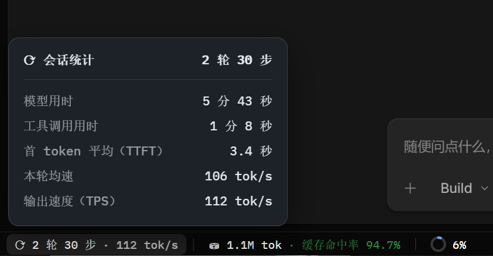
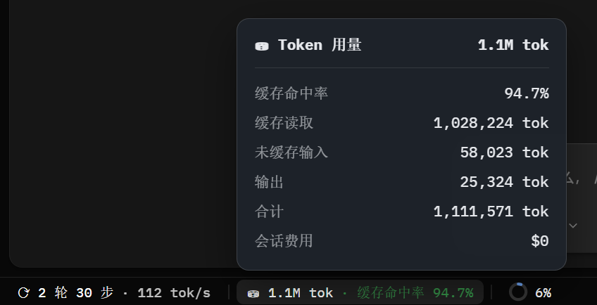
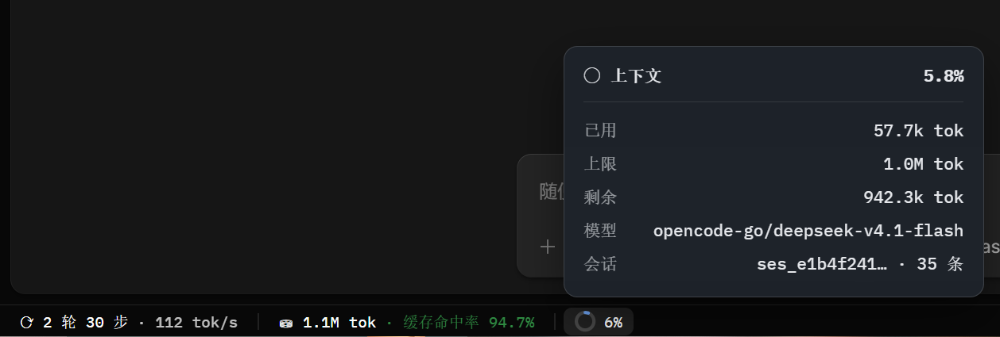

# opencode-infobar

**简体中文** · [English](README.en.md)

给 **OpenCode 桌面版** 的底部加一条 DSH 风格状态栏：轮次/步数 + 速度、总 token + 缓存命中率、上下文比例环。三段都可点按弹出明细。



```
⟳ 3 轮 93 步 · 90 tok/s  │  ⛁ 16.9M tok · 缓存命中率 98%  │  ◔ 27%
```

## 为什么要做这个

OpenCode 桌面版不显示提示词缓存的命中情况、token 的实际到达速度，也不提示上下文还剩多少。TUI 那边有社区插件能做这些，但**桌面版不加载 TUI 插件**——它只挂载插件的 GUI 部位（`./gui-experimental`），而 GUI 插件 API 提供 `window.bottom` 槽位。这个插件就只做这一件事：把它填满。

## 功能

- **三段式**：轮次/步数 + 速度 │ 总 token + 缓存命中率 │ 上下文比例环
- **点按看明细**，点空白或 `Esc` 关闭：
  - `⟳` 轮数、步数、模型用时、工具调用用时、首 token 平均、当前速度
  - `⛁` 缓存读取、未缓存输入、输出、合计、会话费用
  - `◔` 上下文已用 / 上限 / 剩余、模型、会话
- **颜色有意义**：命中率 ≥85% 绿、≥70% 橙、否则红；上下文环超过 80% 转橙、95% 转红
- **跟随主题**：状态栏继承 App 文字色，卡片与圆环按外观模式取深/浅配色
- **零构建**：单个手写 CommonJS 文件，无打包、无依赖
- **不启动 App 也能测**：`node test/smoke.cjs` 用假会话渲染并断言数值

## 截图

| Token 用量卡片 | 上下文卡片 |
| --- | --- |
|  |  |

截图取自真实会话，数字就是当时那次会话的实际表现。

## 环境要求

- **OpenCode 桌面版 2.3.0 或更新**（GUI 插件 API 标注为 experimental，版本间可能变化）
- 其它一概不需要，宿主会提供共享模块

## 安装

1. 把仓库克隆到任意位置，例如 `~/plugins`：

   ```bash
   git clone https://github.com/homecom2233/opencode-infobar ~/plugins/opencode-infobar
   ```

2. 写进**全局**配置 `~/.config/opencode/opencode.json`：

   ```json
   {
     "$schema": "https://opencode.ai/config.json",
     "plugins": ["D:/DSHwork/opencode-infobar"]
   }
   ```

   用绝对路径；相对路径是相对「包含该条目的配置文件」解析的。
3. 刷新窗口（`Ctrl+R`），底部即出现状态栏。

插件 id 取包名/目录名，**目录名即 id**：改名等于换了一个插件。

更新代码后只需刷新窗口——目录安装的 bundle 每次加载都会从磁盘重读，不像 npm 包会被钉在首次解析的版本上（需要清 `~/.cache/opencode/packages` 才行）。

## 数值口径

| 段 | 值 | 公式 |
| --- | --- | --- |
| `⟳ 3 轮 93 步` | 轮数＝用户消息数，步数＝LLM 调用数 | 按已载入的消息统计 |
| `· 90 tok/s` | 最近一步的解码速度 | `(output + reasoning) / 解码窗口` |
| `⛁ 16.9M tok` | 会话总 token | `input + cacheWrite + cacheRead + output + reasoning` |
| `· 缓存命中率 98%` | 缓存命中率 | `cacheRead / (input + cacheRead + cacheWrite)` |
| `◔ 27%` | 上下文占用 | 最近一步的 `input + cacheRead` ÷ 模型 `limit.context` |

token 总量取自 `SessionInfo.tokens`（服务端维护的会话级汇总），所以即使消息分页也不会少算。

### 速度为什么要另算

工具执行发生在**两条 assistant 消息之间**，按消息计算本来就排除了工具等待；误差来自消息内部的时间窗口。在本机 213 条真实 assistant 消息上实测（中位数）：

| 时间窗口 | 含什么 | 中位数 |
| --- | --- | --- |
| `created → completed` | 首 token 等待 **+** 收尾 | 38.6 tok/s |
| `contentFirst → completed` | 去掉首 token 等待，保留收尾 | 86.7 tok/s |
| **`contentFirst → streamed`** | **纯解码，本插件采用** | **136.0 tok/s** |

`time.firstToken` 上报率很低（215 条里只有 8 条），所以起点取 `firstToken ?? 最早的 text/reasoning 片段 time.created ?? created`（工具段不参与，它是在流末尾创建的），终点取 `streamed ?? completed`。卡片里的「模型用时」改用 `created → 最后一帧`，与「工具调用用时」互补，不与解码时间重复。

## 命令

| 命令 | id | 作用 |
| --- | --- | --- |
| 隐藏/显示底部状态栏 | `opencode-infobar.toggle` | 临时收起（刷新后恢复） |
| 复制诊断信息 | `opencode-infobar.copy` | 把所有原始数字复制成 JSON，数值可疑时用 |

## 自定义

全部在 `gui-experimental.cjs`，改完刷新窗口即可：

- 配色：顶部的 `GREEN` / `ORANGE` / `RED`，以及 `theme()` 里的 `ringAccent`
- 文案与段顺序：`buildStrip()`
- 卡片行：`buildPanels()`
- 指标口径：`readSnapshot()` 是唯一出口

目前 UI 文案是中文，改成其它语言只需替换 `buildStrip()` 和 `buildPanels()` 里的字符串。

## 开发

```bash
node test/smoke.cjs
```

这个测试用桩宿主模块 + 假 DOM 加载 bundle，断言三段文本、圆环偏移量和卡片切换，不需要跑 OpenCode。

仓库结构：

```
gui-experimental.cjs      插件本体：GUI 部位，CommonJS，无依赖
package.json              包身份 + exports 映射（./gui-experimental）
test/smoke.cjs            离线冒烟测试
assets/screenshot-*.png   三张卡片的真实截图
```

## 加载机制（给插件作者）

OpenCode 插件是一个包，最多四个部位，由不同宿主加载：

| 部位 | 导出 | 谁加载 | 配置 |
| --- | --- | --- | --- |
| server | `.` / `./server` | 服务端 | `opencode.json(c)` |
| TUI | `./tui` | 终端界面 | `cli.json` |
| GUI | `./gui-experimental` | OpenCode 桌面版 | 全局 `opencode.json(c)` |

GUI bundle 以 CommonJS 执行，`require` 只能解析这些模块：`@opencode/plugin/gui`、`@opencode/plugin/rpc`、`@opencode/schema/rpc`、`@opencode/client`、`@opencode/client/effect`、`@opencode/client/solid`、`effect`、`solid-js`、`solid-js/web`、`solid-js/store`，以及 Node 内置模块与 `electron` 的惰性占位符。用其它模块会抛 `Plugin GUI bundle requires a module the app does not share`。`solid-js/h` **不在**白名单里，所以本插件手写 DOM，并用 `insert` / `createMemo` 接响应式。

bundle 必须 default-export 一个 `Plugin.define`，且至少声明 `setup` 或 `main` 之一。

## 已知限制

- **轮/步按已载入消息统计**：长会话消息是分页的，数字可能偏小；token 总量与命中率不受影响。
- **上下文环依赖 `limit.context`**：provider 不报模型上限时该环显示 `—`。
- **GUI 插件 API 是 experimental**：未来版本可能变更。
- 只有一条 assistant 消息的会话里，速度没有可比对的趋势。

## 卸载

从全局 `opencode.json` 的 `plugins` 里删掉对应条目，重启 OpenCode；目录可以留着。

## 许可

MIT，见 [LICENSE](LICENSE)。
